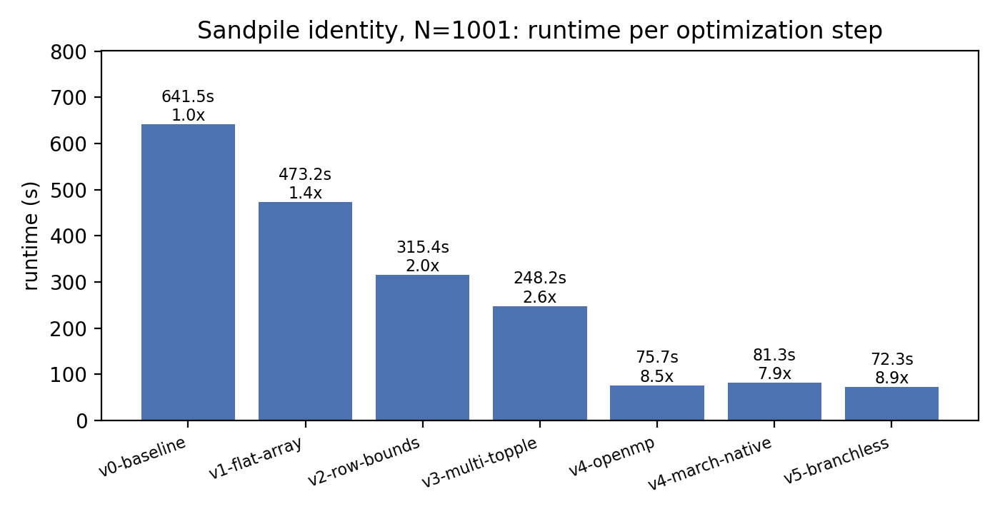
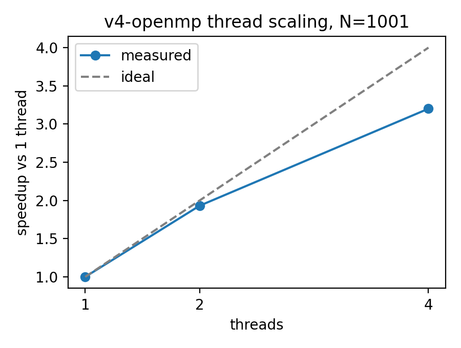

# CS598APE HW3: Optimized Abelian Sandpile

**Author:** Ran "Steven" Xiao (sx37)

This repo computes the identity sandpile of the 1001×1001 pacman grid. It is **8.9× faster** than the provided code (641 s → 72 s on the course VM), and its output is byte-identical to the original.


---

## Requirements

| Tool | Needed for |
|---|---|
| `gcc` with OpenMP (gcc ≥ 9), `make` | building |
| `bash`, `awk`, `cmp` | `bench.sh` / `scaling.sh` |
| `perf` (optional) | profiling inside `bench.sh` |
| `python3` + `matplotlib` (optional) | `plot.py` charts (`sudo apt install python3-matplotlib`) |

**Machine used for every number below:** course VM, 4 vCPUs of an Intel Xeon Silver 4216 @ 2.10 GHz (1 MiB L2 per core, 22 MiB shared L3), Ubuntu 26.04.1 LTS, gcc 15.2.0.

To profile without root, run `sudo sysctl kernel.perf_event_paranoid=1` first.

**Optional Docker environment** (not used for the reported numbers):
```bash
docker build -t sandpile docker/
./dockerrun.sh     # mounts this repo at /host
cd /host
```

---

## Build and run

```bash
make all
./sandpile.exe 1001          # writes identity.png
```

Set the thread count with `OMP_NUM_THREADS` (the default is all cores).

---

## Verify correctness

Every version produces an `identity.png` that is **byte-identical** to the baseline's. `bench.sh` checks this automatically on every run, comparing against `refs/identity-<N>.png` (written by the baseline run), and prints `correct=yes` or `correct=NO`.

To check by hand:
```bash
cp stages/v0_baseline.c sandpile.c && make all && ./sandpile.exe 301 && cp identity.png /tmp/ref.png
git checkout -- sandpile.c        && make all && ./sandpile.exe 301 && cmp identity.png /tmp/ref.png && echo identical
```

---

## Optimizations

Each optimization is its own commit (`git show <hash>` shows its diff). Each one is also saved as a standalone file in `stages/`.

| # | Optimization | Kind | Code commit | Stage file | Time (s) | vs. baseline | vs. previous |
|---|---|---|---|---|---|---|---|
| 0 | Baseline (provided code) | – | `58be83c` | `v0_baseline.c` | 641.5 | 1.00× | – |
| 1 | Flat padded grid; globals copied to locals | data structure | `974a8ff` | `v1_flat_array.c` | 473.2 | 1.36× | 1.36× |
| 2 | Per-row bounds of the shape | work reduction | `f6f5f79` | `v2_row_bounds.c` | 315.4 | 2.03× | 1.50× |
| 3 | Multi-topple (`q = g >> 2`) | algorithmic | `533b192` | `v3_multi_topple.c` | 248.2 | 2.58× | 1.27× |
| 4 | OpenMP 3-phase row parallelism (4 threads) | parallelism | `6be13c1` | `v4_openmp.c` | 75.7 | 8.48× | 3.28× |
| 5 | Branch-free toppling loop (4 threads) | branch elimination | `e55b28c` | `v5_branchless.c` | 72.3 | 8.87× | 1.05× |

All times are at N=1001, median of the runs in `results/results.csv` (1 run for v0–v3, 3 for v4–v5).

**Tried, did not help:**

| Experiment | Result | Why |
|---|---|---|
| `-march=native` on v4 | 81.3 s, 7% slower | The inner loop carries a dependence from cell j to cell j+1, so it doesn't vectorize and the wider instructions buy nothing |

`REPORT_NOTES.md` explains why each optimization is correct and what it assumes.

---

## Reproduce the benchmarks

Benchmark one version (it builds, times, checks correctness, profiles, and writes `results/<label>/summary.md`):
```bash
cp stages/v0_baseline.c sandpile.c && ./bench.sh v0-baseline 1001 1       # run first: creates the reference image
cp stages/v1_flat_array.c sandpile.c && ./bench.sh v1-flat-array 1001 1
cp stages/v2_row_bounds.c sandpile.c && ./bench.sh v2-row-bounds 1001 1
cp stages/v3_multi_topple.c sandpile.c && ./bench.sh v3-multi-topple 1001 1
cp stages/v4_openmp.c sandpile.c && ./bench.sh v4-openmp 1001 3
cp stages/v5_branchless.c sandpile.c && ./bench.sh v5-branchless 1001 3
git checkout -- sandpile.c
```
Because `sandpile.c` is overwritten, `bench.sh` marks the commit hash as `-dirty`. That's expected here, since the stage file names exactly which code ran. The baseline alone takes about 11 minutes, so for a quick check use `N=301`.

Other experiments:
```bash
cp stages/v4_openmp.c sandpile.c && ./scaling.sh v4-openmp 1001 1                  # 1/2/4 threads
cp stages/v4_openmp.c sandpile.c && EXTRA=-march=native ./bench.sh v4-march-native 1001 3
python3 plot.py 1001                                                                # results/summary.md + charts
```

`bench.sh` options: `OMP_NUM_THREADS`, `EXTRA` (extra compiler flags), `PERF_N` (profiling size, default 301), `SKIP_PERF=1`.

---

## Results (course VM, N=1001)



**Thread scaling of v4:**

| Threads | Time (s) | Speedup | Efficiency |
|---|---|---|---|
| 1 | 250.3 | 1.00× | 100% |
| 2 | 129.6 | 1.93× | 97% |
| 4 | 78.2 | 3.20× | 80% |



Each step's full report (timings, `perf stat` counters, hotspots) is in `results/<step>/summary.md`.
